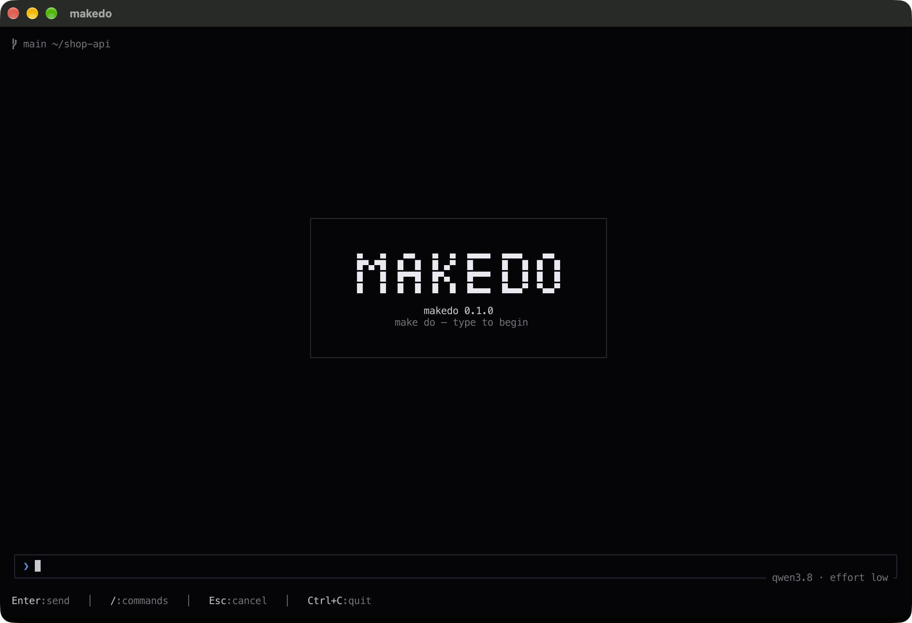

<p align="center">
  
</p>

<h1 align="center">makedo</h1>

<p align="center"><b>Serious codebases on cheap models.</b></p>

<p align="center">A coding agent in Rust: one binary, in your terminal or in its own window.</p>

<p align="center">
  <a href="LICENSE"></a>
  
  
</p>

<p align="center">
  <a href="#what-it-is">About</a> ·
  <a href="#installation">Installation</a> ·
  <a href="#quick-start">Quick start</a> ·
  <a href="#documentation">Documentation</a>
</p>

<p align="center">
  <b>English</b> ·
  <a href="docs/README.ru.md">Русский</a> ·
  <a href="docs/README.es.md">Español</a> ·
  <a href="docs/README.zh-CN.md">简体中文</a> ·
  <a href="docs/README.ja.md">日本語</a>
</p>

<p align="center">
  
</p>

---

## What it is

makedo is an agent that writes and edits code in your repository. The name comes
from *make do*: getting by with what you have.

Cheap models (DeepSeek, Qwen, local ones) fail on real codebases not for lack of
intelligence but for lack of context discipline: they wander around the
repository, re-read files and reinvent conventions that already exist. makedo
closes that gap with three things:

1. **A knowledge layer.** An LLM wiki in `.makedo/wiki/` — a versioned graph of
   facts about the project. It lives in git and is filled in by a cheap model.
2. **Discipline.** Search the wiki before grep; write down what you learn; be
   brief by default (the ponytail skill).
3. **Self-checking.** The agent must run type checks and tests until they pass.

## In numbers

| What | How much |
|---|---|
| A feature with tests and self-checking | **$0.13** on deepseek-v4-pro with a warmed-up wiki, versus $3.5–5.2 on sonnet at comparable quality |
| With the wiki | the fastest and most stable runs (5.8 and 6.0 min against 8–24 min) and compact diffs |
| Filling the wiki | about $0.15 for a 350k-line monorepo |
| Budgets (CI gates) | startup < 150 ms, idle memory < 50 MB, binary < 15 MB |

One task from a real backlog, five setups, the same three-stage acceptance:

| Setup | Accepted | Time | Cost |
|---|---|---|---|
| makedo + deepseek-v4-flash + wiki | ✓ | 3.1 min | **$0.014** |
| makedo + deepseek-v4-pro + wiki | ✓ | 5.9 min | $0.036 |
| makedo + local qwen3.8 27b + wiki | ✓ | 14.9 min | **$0** |
| `claude -p`, sonnet 5, no wiki | ✓ | 4.9 min | $2.19 |
| `claude -p`, opus 5, no wiki | ✓ | 4.7 min | $2.56 |

These are the project's own measurements on small samples. Full tables and their
limits: [docs/BENCHMARKS.md](docs/BENCHMARKS.md).

## Features

- **Any model.** Anthropic, OpenAI, Gemini, DeepSeek, Qwen, OpenRouter, local
  Ollama, your own OpenAI-compatible servers, and a ChatGPT subscription.
- **Wiki and project memory.** A knowledge graph in git plus SQLite memory with
  full-text and semantic search, shared by all worktrees.
- **Subagents and worktrees.** Read-only research, and edits in an isolated
  working copy.
- **MCP both ways.** Connect servers through meta-tools (`search_tool` /
  `use_tool`); `makedo mcp-serve` exposes the wiki and memory to other agents.
- **Built-in skills.** Ponytail, Open Code Review, Heavy, and the DDD and
  hexagonal-architecture doctrines — inside the binary, no external directories.
- **Safe file editing.** SHA-256 versions, atomic writes, locks shared across
  sessions.
- **Session resume.** `makedo --resume latest` restores the history.
- **A macOS window.** The same interface as an app with a Dock icon.

## Installation

### Requirements

- **System:** Linux x86_64 (glibc or musl) or macOS 11+ (Intel and Apple Silicon).
- **A model:** an API key (for example `DEEPSEEK_API_KEY`, `ANTHROPIC_API_KEY`,
  `OPENAI_API_KEY`), a ChatGPT subscription, or local Ollama.
- **Git:** for the wiki, memory and worktrees; `makedo finish` needs 2.38 or newer.
- **Optional:** Ollama with the `embeddinggemma` model (semantic search in
  memory), and the external tools `heavy` and `ocr`.

### Prebuilt binary

```sh
curl -fsSL https://raw.githubusercontent.com/ts-ign0re/makedo/main/install.sh | sh
```

The script detects your platform, downloads the latest release and puts `makedo`
in `~/.local/bin`. Set `MAKEDO_INSTALL_DIR` to use another directory.

### From source

Requires Rust 1.95 or newer.

```sh
git clone https://github.com/ts-ign0re/makedo && cd makedo
cargo install --path . --locked --profile dist
```

### macOS app

```sh
scripts/bundle-macos.sh        # builds target/Makedo.app
cp -R target/Makedo.app /Applications/
```

Building requires the Xcode Command Line Tools. On launch the app asks for a
project folder; `open -a Makedo --args ~/proj` opens one directly. Text is drawn
with the system Menlo font; glyphs it lacks (braille spinners, the branch icon in
the header) come from JuliaMono (OFL), which is downloaded at build time. Change
the text font with `MAKEDO_FONT` (a file path) and its size with
`MAKEDO_FONT_SIZE` (points, 14 by default).

This is a prototype: it is ad-hoc signed (on another Mac you will have to allow it
manually), and there is no mouse text selection, no emoji, and no Linux or Windows
build. Without the bundle, run the window with
`MAKEDO_SYMBOLS_FONT=target/fonts/JuliaMono-Regular.ttf cargo run --features gui -- app`.

## Quick start

```sh
cd your-project
makedo                                  # the interface; on first run, pick a provider and model
makedo login chatgpt                    # sign in with a ChatGPT subscription
makedo -p "add a test for the cart" --yolo   # headless, tools are approved automatically
makedo --resume latest                  # continue the last session
```

| Command | What it does |
|---|---|
| `makedo models [--refresh]` | the model catalog and its refresh |
| `makedo wiki check` | checks the wiki's integrity |
| `makedo memory status\|search\|read\|write\|export` | project memory from the command line |
| `makedo skills [name]` | built-in skills |
| `makedo mcp-serve` | an MCP server with the wiki and memory for other agents |
| `makedo --worktree <name>`, `makedo finish <name>` | work in a separate working copy, then merge it |
| `makedo demo` | the interface on fixture events, with no model requests |

In the interface: `/models`, `/effort`, `/theme`, `/doctrine`, `/ponytail`,
`/agents`, `/logs`, `/init`, `/worktree`, `/finish`, `/enrich`, `/create-image`,
`/yolo`, `/clear`, `/help`, `/quit`.

## Documentation

Most of the documentation is in Russian.

- [Reference](docs/REFERENCE.md) — providers and models, message queueing, file
  editing, logs, skills, memory
- [Product core](docs/CORE.md) — the thesis, positioning, measurements
- [Plan and principles](docs/PLAN.md)
- [Dependencies](docs/DEPS.md)
- [Reasoning modes](docs/REASONING.md)
- [Memory](docs/MEMORY.md)
- [Worktrees](docs/WORKTREES.md)

## License

makedo is distributed under the **GNU General Public License, version 3 or
later** (GPL-3.0-or-later). The full text is in [LICENSE](LICENSE).

Third-party components and their licenses are listed in
[THIRD-PARTY-NOTICES.md](THIRD-PARTY-NOTICES.md). The JuliaMono font in the macOS
app is distributed under the SIL Open Font License; its license ships in the
bundle next to the font.
