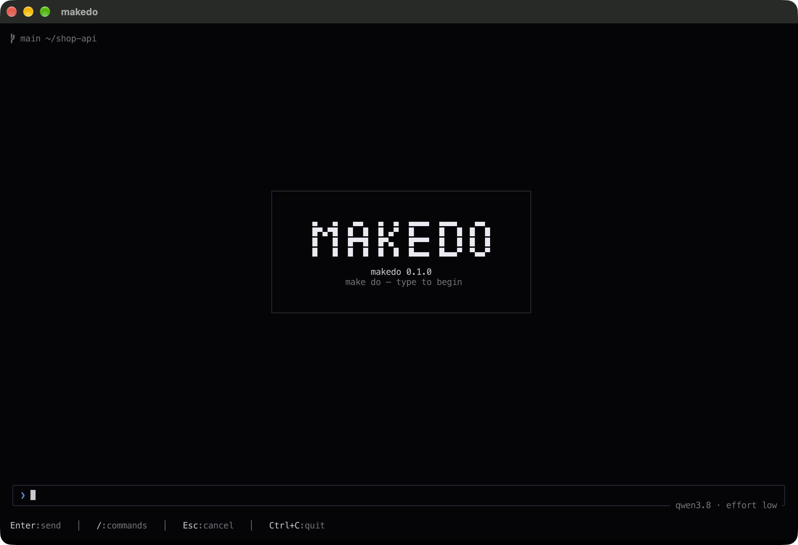

<p align="center">
  
</p>

<h1 align="center">makedo</h1>

<p align="center"><b>Bases de código serias con modelos baratos.</b></p>

<p align="center">Un agente de programación en Rust: un solo binario, en tu terminal o en su propia ventana.</p>

<p align="center">
  <a href="https://github.com/ts-ign0re/makedo/actions/workflows/ci.yml"></a>
  <a href="../LICENSE"></a>
  
  
</p>

<p align="center">
  <a href="#qué-es">Qué es</a> ·
  <a href="#instalación">Instalación</a> ·
  <a href="#inicio-rápido">Inicio rápido</a> ·
  <a href="#documentación">Documentación</a>
</p>

<p align="center">
  <a href="../README.md">English</a> ·
  <a href="README.ru.md">Русский</a> ·
  <b>Español</b> ·
  <a href="README.zh-CN.md">简体中文</a> ·
  <a href="README.ja.md">日本語</a>
</p>

<p align="center">
  
</p>

---

## Qué es

makedo es un agente que escribe y modifica código en tu repositorio. El nombre
viene del inglés *make do*: arreglárselas con lo que hay.

Los modelos baratos (DeepSeek, Qwen, los locales) fracasan en bases de código
reales no por falta de inteligencia, sino por falta de disciplina de contexto:
deambulan por el repositorio, releen archivos y reinventan convenciones que ya
existen. makedo cierra esa brecha con tres cosas:

1. **Una capa de conocimiento.** Una wiki para LLM en `.makedo/wiki/`: un grafo
   versionado de hechos sobre el proyecto. Vive en git y la rellena un modelo barato.
2. **Disciplina.** Primero buscar en la wiki, después grep; lo que se aprende se
   anota; brevedad por defecto (la skill ponytail).
3. **Autoverificación.** El agente está obligado a ejecutar la comprobación de
   tipos y las pruebas hasta que pasen.

## En cifras

| Qué | Cuánto |
|---|---|
| Una funcionalidad con pruebas y autoverificación | **$0.13** con deepseek-v4-pro y la wiki ya preparada, frente a $3.5–5.2 con sonnet con una calidad comparable |
| Con la wiki | las ejecuciones más rápidas y estables (5,8 y 6,0 min frente a 8–24 min) y diffs compactos |
| Rellenar la wiki | unos $0.15 para un monorepo de 350 mil líneas |
| Presupuestos (controles en CI) | arranque < 150 ms, memoria en reposo < 50 MB, binario < 15 MB |

Una tarea de un backlog real, cinco configuraciones, la misma aceptación en tres etapas:

| Configuración | Aceptada | Tiempo | Coste |
|---|---|---|---|
| makedo + deepseek-v4-flash + wiki | ✓ | 3.1 min | **$0.014** |
| makedo + deepseek-v4-pro + wiki | ✓ | 5.9 min | $0.036 |
| makedo + qwen3.8 27b local + wiki | ✓ | 14.9 min | **$0** |
| `claude -p`, sonnet 5, sin wiki | ✓ | 4.9 min | $2.19 |
| `claude -p`, opus 5, sin wiki | ✓ | 4.7 min | $2.56 |

Son mediciones propias del proyecto con muestras pequeñas. Las tablas completas y
sus límites están en [BENCHMARKS.md](BENCHMARKS.md) (en inglés).

## Características

- **Cualquier modelo.** Anthropic, OpenAI, Gemini, DeepSeek, Qwen, OpenRouter,
  Ollama en local, tus propios servidores compatibles con OpenAI y la suscripción
  de ChatGPT.
- **Wiki y memoria del proyecto.** Un grafo de conocimiento en git más una memoria
  en SQLite con búsqueda de texto completo y semántica, compartida por todos los
  worktrees.
- **Subagentes y worktrees.** Investigación en modo de solo lectura y cambios en
  una copia de trabajo aislada.
- **MCP en ambos sentidos.** Conexión de servidores mediante metaherramientas
  (`search_tool` / `use_tool`); `makedo mcp-serve` expone la wiki y la memoria a
  otros agentes.
- **Skills integradas.** Ponytail, Open Code Review, Heavy y las doctrinas de DDD
  y arquitectura hexagonal: dentro del binario, sin directorios externos.
- **Edición segura de archivos.** Versiones por SHA-256, escritura atómica,
  bloqueos compartidos entre sesiones.
- **Reanudación de sesiones.** `makedo --resume latest` restaura el historial.
- **Ventana para macOS.** La misma interfaz como aplicación con icono en el Dock.

## Instalación

### Requisitos

- **Sistema:** Linux x86_64 o arm64, o macOS 11+ (Intel y Apple Silicon).
- **Un modelo:** una clave de API (por ejemplo `DEEPSEEK_API_KEY`,
  `ANTHROPIC_API_KEY`, `OPENAI_API_KEY`), la suscripción de ChatGPT u Ollama en local.
- **Git:** para la wiki, la memoria y los worktrees; `makedo finish` necesita la
  versión 2.38 o posterior.
- **Opcional:** Ollama con el modelo `embeddinggemma` (búsqueda semántica en la
  memoria) y las herramientas externas `heavy` y `ocr`.

### Binario precompilado

```sh
curl -fsSL https://raw.githubusercontent.com/ts-ign0re/makedo/main/install.sh | sh
```

El script detecta tu plataforma, descarga la última versión y deja `makedo` en
`~/.local/bin`. Para usar otro directorio, define `MAKEDO_INSTALL_DIR`.

### Desde el código fuente

Requiere Rust 1.95 o posterior.

```sh
git clone https://github.com/ts-ign0re/makedo && cd makedo
cargo install --path . --locked --profile dist
```

### Aplicación para macOS

```sh
curl -fsSL https://raw.githubusercontent.com/ts-ign0re/makedo/main/install.sh | sh -s -- --app
```

El comando instala también la CLI y deja `Makedo.app` en `/Applications`, o en
`~/Applications` si esa carpeta no admite escritura. Al abrirse, la aplicación
pregunta por la carpeta del proyecto; `open -a Makedo --args ~/proj` la abre
directamente.

El texto se dibuja con la fuente Menlo del sistema; los glifos que le faltan (los
spinners en braille, el icono de rama de la cabecera) salen de JuliaMono (OFL),
incluida en la aplicación. La fuente del texto se cambia con `MAKEDO_FONT` (ruta a
un archivo) y su tamaño con `MAKEDO_FONT_SIZE` (en puntos, 14 por defecto).

Es un prototipo: no hay selección de texto con el ratón, ni emoji, ni versiones
para Linux o Windows. Para compilar la aplicación desde el código fuente, ejecuta
`scripts/bundle-macos.sh` (requiere las Xcode Command Line Tools); el resultado es
`target/Makedo.app`.

## Inicio rápido

```sh
cd your-project
makedo                                  # la interfaz; en el primer arranque, elige proveedor y modelo
makedo login chatgpt                    # inicia sesión con la suscripción de ChatGPT
makedo -p "añade una prueba para el carrito" --yolo   # sin interfaz, las herramientas se aprueban solas
makedo --resume latest                  # continúa la última sesión
```

| Comando | Qué hace |
|---|---|
| `makedo models [--refresh]` | el catálogo de modelos y su actualización |
| `makedo wiki check` | comprueba la integridad de la wiki |
| `makedo memory status\|search\|read\|write\|export` | la memoria del proyecto desde la línea de comandos |
| `makedo skills [nombre]` | las skills integradas |
| `makedo mcp-serve` | un servidor MCP con la wiki y la memoria para otros agentes |
| `makedo --worktree <nombre>`, `makedo finish <nombre>` | trabajar en una copia de trabajo aparte y fusionarla después |
| `makedo demo` | la interfaz con eventos de prueba, sin peticiones al modelo |

En la interfaz: `/models`, `/effort`, `/theme`, `/doctrine`, `/ponytail`,
`/agents`, `/logs`, `/init`, `/worktree`, `/finish`, `/enrich`, `/create-image`,
`/yolo`, `/clear`, `/help`, `/quit`.

## Documentación

La mayor parte de la documentación está en ruso.

- [Referencia](REFERENCE.md) — proveedores y modelos, cola de mensajes, edición de
  archivos, registros, skills, memoria
- [Núcleo del producto](CORE.md) — la tesis, el posicionamiento, las mediciones
- [Plan y principios](PLAN.md)
- [Dependencias](DEPS.md)
- [Modos de razonamiento](REASONING.md)
- [Memoria](MEMORY.md)
- [Worktrees](WORKTREES.md)

## Licencia

makedo se distribuye bajo la **Licencia Pública General de GNU, versión 3 o
posterior** (GPL-3.0-or-later). El texto completo está en [LICENSE](../LICENSE).

Los componentes de terceros y sus licencias figuran en
[THIRD-PARTY-NOTICES.md](../THIRD-PARTY-NOTICES.md). La fuente JuliaMono de la
aplicación para macOS se distribuye bajo la SIL Open Font License; su licencia va
incluida en el bundle, junto a la fuente.
