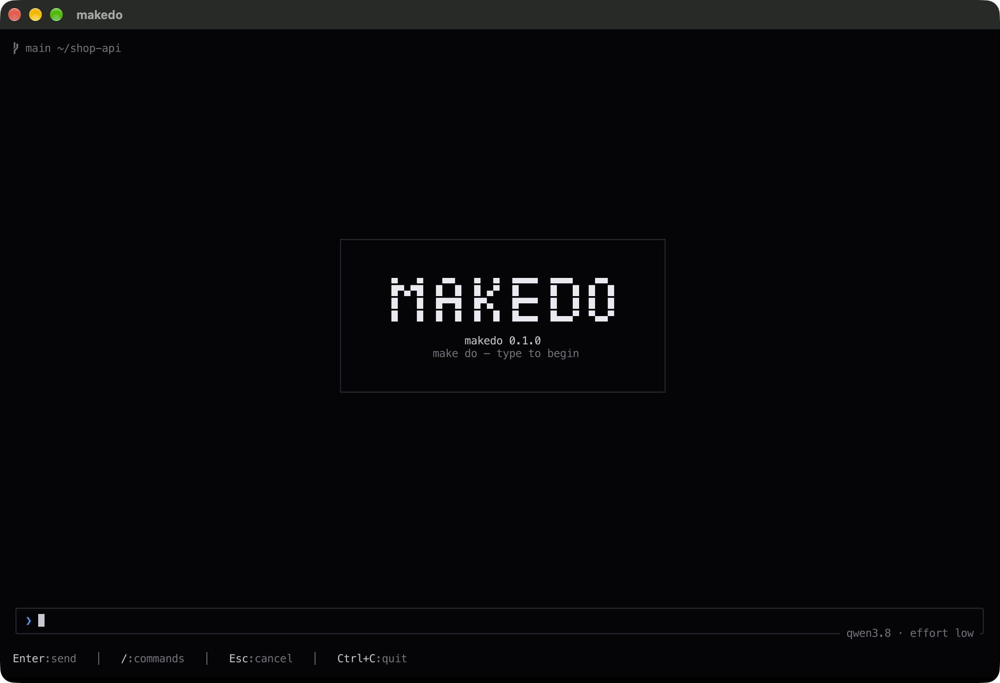

<p align="center">
  
</p>

<h1 align="center">makedo</h1>

<p align="center"><b>安価なモデルで、本格的なコードベースを。</b></p>

<p align="center">Rust 製のコーディングエージェント。単一バイナリで、ターミナルでも専用ウィンドウでも動きます。</p>

<p align="center">
  <a href="../LICENSE"></a>
  
  
</p>

<p align="center">
  <a href="#makedo-とは">概要</a> ·
  <a href="#インストール">インストール</a> ·
  <a href="#クイックスタート">クイックスタート</a> ·
  <a href="#ドキュメント">ドキュメント</a>
</p>

<p align="center">
  <a href="../README.md">English</a> ·
  <a href="README.ru.md">Русский</a> ·
  <a href="README.es.md">Español</a> ·
  <a href="README.zh-CN.md">简体中文</a> ·
  <b>日本語</b>
</p>

<p align="center">
  
</p>

---

## makedo とは

makedo は、あなたのリポジトリでコードを書き、修正するエージェントです。名前は英語の
*make do*（手元にあるもので何とかする）に由来します。

安価なモデル（DeepSeek、Qwen、ローカルモデル）が実際のコードベースでうまくいかないのは、
知能が足りないからではなく、コンテキストの規律が足りないからです。リポジトリの中を
さまよい、同じファイルを読み直し、すでにある規約を作り直してしまいます。makedo は
この差を次の 3 つで埋めます。

1. **知識レイヤー。** `.makedo/wiki/` にある LLM wiki。プロジェクトに関する事実を
   バージョン管理したグラフです。git に置かれ、安価なモデルが内容を埋めます。
2. **規律。** grep の前にまず wiki を検索する。学んだことは書き残す。既定で簡潔にする
   （ponytail スキル）。
3. **自己検証。** エージェントは、型チェックとテストが通るまで実行し続けなければ
   なりません。

## 数字で見る

| 項目 | 数値 |
|---|---|
| テストと自己検証つきの機能 1 つ | wiki が温まった状態の deepseek-v4-pro で **$0.13**。同程度の品質の sonnet では $3.5–5.2 |
| wiki を使った場合 | 最も速く安定した実行（5.8 分と 6.0 分。ほかは 8–24 分）と、コンパクトな差分 |
| wiki の構築 | 35 万行のモノレポで約 $0.15 |
| 性能予算（CI のゲート） | 起動 < 150 ms、アイドル時メモリ < 50 MB、バイナリ < 15 MB |

実際のバックログから取ったタスク 1 つを、5 つの構成で、同じ 3 段階の受け入れ基準で比べました。

| 構成 | 受け入れ | 時間 | コスト |
|---|---|---|---|
| makedo + deepseek-v4-flash + wiki | ✓ | 3.1 分 | **$0.014** |
| makedo + deepseek-v4-pro + wiki | ✓ | 5.9 分 | $0.036 |
| makedo + ローカルの qwen3.8 27b + wiki | ✓ | 14.9 分 | **$0** |
| `claude -p`、sonnet 5、wiki なし | ✓ | 4.9 分 | $2.19 |
| `claude -p`、opus 5、wiki なし | ✓ | 4.7 分 | $2.56 |

これらはプロジェクト自身が小さなサンプルで計測したものです。完全な表とその限界は
[BENCHMARKS.md](BENCHMARKS.md)（英語）にあります。

## 機能

- **どのモデルでも。** Anthropic、OpenAI、Gemini、DeepSeek、Qwen、OpenRouter、
  ローカルの Ollama、自前の OpenAI 互換サーバー、ChatGPT のサブスクリプション。
- **wiki とプロジェクトメモリ。** git 上の知識グラフに加え、全文検索とセマンティック
  検索ができる SQLite メモリ。すべての worktree で共有されます。
- **サブエージェントと worktree。** 読み取り専用の調査と、隔離された作業コピーでの編集。
- **双方向の MCP。** メタツール（`search_tool` / `use_tool`）経由でサーバーに接続。
  `makedo mcp-serve` は wiki とメモリをほかのエージェントに公開します。
- **組み込みスキル。** Ponytail、Open Code Review、Heavy、DDD とヘキサゴナル
  アーキテクチャのドクトリン。すべてバイナリに含まれ、外部ディレクトリは不要です。
- **安全なファイル編集。** SHA-256 によるバージョン、アトミックな書き込み、セッション間で
  共有されるロック。
- **セッションの再開。** `makedo --resume latest` で履歴を復元します。
- **macOS 用ウィンドウ。** 同じインターフェースを、Dock にアイコンのあるアプリとして
  使えます。

## インストール

### 必要なもの

- **システム:** Linux x86_64 または arm64、あるいは macOS 11 以降（Intel と
  Apple Silicon）。
- **モデル:** API キー（例: `DEEPSEEK_API_KEY`、`ANTHROPIC_API_KEY`、
  `OPENAI_API_KEY`）、ChatGPT のサブスクリプション、またはローカルの Ollama。
- **Git:** wiki、メモリ、worktree に使います。`makedo finish` には 2.38 以降が必要です。
- **任意:** `embeddinggemma` モデルを入れた Ollama（メモリのセマンティック検索）、
  外部ツールの `heavy` と `ocr`。

### ビルド済みバイナリ

```sh
curl -fsSL https://raw.githubusercontent.com/ts-ign0re/makedo/main/install.sh | sh
```

スクリプトがプラットフォームを判別し、最新リリースをダウンロードして `makedo` を
`~/.local/bin` に置きます。別のディレクトリにしたい場合は `MAKEDO_INSTALL_DIR` を
設定してください。

### ソースから

Rust 1.95 以降が必要です。

```sh
git clone https://github.com/ts-ign0re/makedo && cd makedo
cargo install --path . --locked --profile dist
```

### macOS アプリ

```sh
scripts/bundle-macos.sh        # target/Makedo.app をビルド
cp -R target/Makedo.app /Applications/
```

ビルドには Xcode Command Line Tools が必要です。アプリは起動時にプロジェクトの
フォルダを尋ねます。`open -a Makedo --args ~/proj` とすれば直接開けます。テキストは
システムの Menlo フォントで描画し、Menlo にないグリフ（点字のスピナー、ヘッダーの
ブランチアイコン）は JuliaMono（OFL）から取ります。JuliaMono はビルド時にダウンロード
されます。テキストのフォントは `MAKEDO_FONT`（ファイルのパス）で、サイズは
`MAKEDO_FONT_SIZE`（ポイント、既定は 14）で変更できます。

これはプロトタイプです。署名は ad-hoc で（ほかの Mac では手動で実行を許可する必要が
あります）、マウスによるテキスト選択、絵文字、Linux 版と Windows 版はありません。
バンドルなしでウィンドウを起動するには次のようにします:
`MAKEDO_SYMBOLS_FONT=target/fonts/JuliaMono-Regular.ttf cargo run --features gui -- app`

## クイックスタート

```sh
cd your-project
makedo                                  # インターフェース。初回起動時にプロバイダーとモデルを選びます
makedo login chatgpt                    # ChatGPT のサブスクリプションでログイン
makedo -p "カートのテストを追加して" --yolo   # インターフェースなし、ツールは自動で承認
makedo --resume latest                  # 直前のセッションを続ける
```

| コマンド | 内容 |
|---|---|
| `makedo models [--refresh]` | モデルカタログとその更新 |
| `makedo wiki check` | wiki の整合性チェック |
| `makedo memory status\|search\|read\|write\|export` | コマンドラインからプロジェクトメモリを操作 |
| `makedo skills [名前]` | 組み込みスキル |
| `makedo mcp-serve` | wiki とメモリをほかのエージェントに提供する MCP サーバー |
| `makedo --worktree <名前>`、`makedo finish <名前>` | 別の作業コピーで作業し、あとでマージ |
| `makedo demo` | テスト用イベントでインターフェースを表示（モデルへのリクエストなし） |

インターフェース内で使えるコマンド: `/models`、`/effort`、`/theme`、`/doctrine`、
`/ponytail`、`/agents`、`/logs`、`/init`、`/worktree`、`/finish`、`/enrich`、
`/create-image`、`/yolo`、`/clear`、`/help`、`/quit`。

## ドキュメント

ドキュメントの大半はロシア語です。

- [リファレンス](REFERENCE.md): プロバイダーとモデル、メッセージキュー、ファイル編集、
  ログ、スキル、メモリ
- [プロダクトの核](CORE.md): 主張、ポジショニング、計測
- [計画と原則](PLAN.md)
- [依存関係](DEPS.md)
- [推論モード](REASONING.md)
- [メモリ](MEMORY.md)
- [Worktree](WORKTREES.md)

## ライセンス

makedo は **GNU General Public License バージョン 3 またはそれ以降**
（GPL-3.0-or-later）で配布されます。全文は [LICENSE](../LICENSE) にあります。

サードパーティのコンポーネントとそのライセンスは
[THIRD-PARTY-NOTICES.md](../THIRD-PARTY-NOTICES.md) に記載しています。macOS アプリに
含まれる JuliaMono フォントは SIL Open Font License で配布され、そのライセンスは
フォントと一緒にバンドルに入っています。
