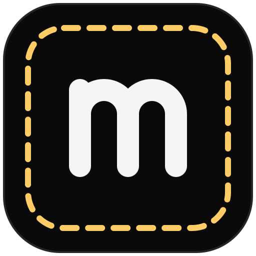
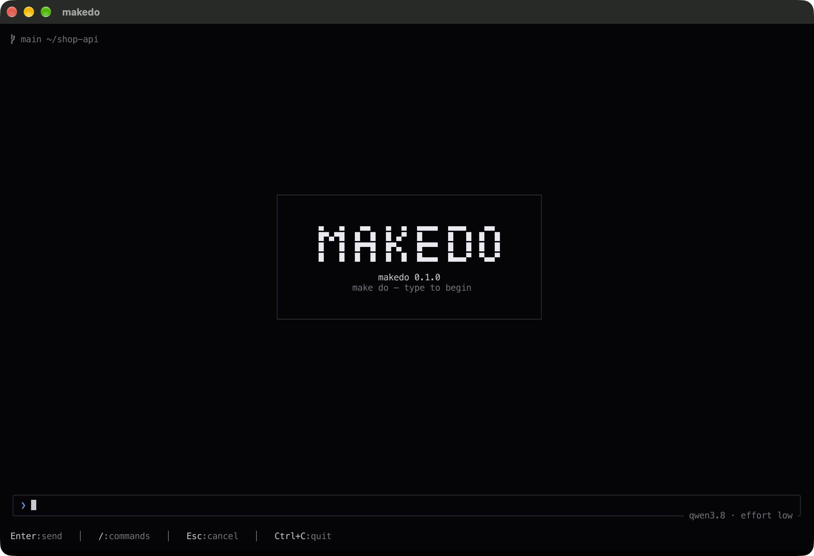

<p align="center">
  
</p>

<h1 align="center">makedo</h1>

<p align="center"><b>Серьёзная кодовая база на дешёвых моделях.</b></p>

<p align="center">Агент для кодинга на Rust: один бинарь, в терминале или в собственном окне.</p>

<p align="center">
  <a href="../LICENSE"></a>
  
  
</p>

<p align="center">
  <a href="#что-это">О проекте</a> ·
  <a href="#установка">Установка</a> ·
  <a href="#быстрый-старт">Быстрый старт</a> ·
  <a href="#документация">Документация</a>
</p>

<p align="center">
  <a href="../README.md">English</a> ·
  <b>Русский</b> ·
  <a href="README.es.md">Español</a> ·
  <a href="README.zh-CN.md">简体中文</a> ·
  <a href="README.ja.md">日本語</a>
</p>

<p align="center">
  
</p>

---

## Что это

makedo — агент, который пишет и правит код в вашем репозитории. Название — от
английского *make do*: обходиться тем, что есть.

Дешёвые модели (DeepSeek, Qwen, локальные) проваливают реальные кодовые базы не
от нехватки интеллекта, а от нехватки контекстной дисциплины: блуждают по
репозиторию, перечитывают файлы, изобретают чужие конвенции. makedo закрывает
этот разрыв тремя вещами:

1. **Слой знаний.** LLM-wiki в `.makedo/wiki/` — версионируемый граф фактов о
   проекте. Лежит в git и наполняется дешёвой моделью.
2. **Дисциплина.** Сначала поиск по wiki, потом grep; узнал — записал; краткость
   по умолчанию (скилл ponytail).
3. **Самопроверка.** Агент обязан гонять проверку типов и тесты до зелёного
   результата.

## В цифрах

| Что | Сколько |
|---|---|
| Фича с тестами и самопроверкой | **$0.13** на deepseek-v4-pro по прогретой wiki против $3.5–5.2 на sonnet при сопоставимом качестве |
| Вклад wiki | полная стоимость прогона ниже на 17–57 % |
| Наполнение wiki | около $0.15 на монорепозиторий в 350 тыс. строк |
| Бюджеты (гейты в CI) | старт < 150 мс, память в простое < 50 MB, бинарь < 15 MB |

Это собственные замеры проекта: 22 прогона в [benchmarks/betslip-ab](../benchmarks/betslip-ab),
разбор — в [docs/CORE.md](CORE.md).

## Возможности

- **Любые модели.** Anthropic, OpenAI, Gemini, DeepSeek, Qwen, OpenRouter, локальный
  Ollama, свои OpenAI-совместимые серверы и подписка ChatGPT.
- **Wiki и память проекта.** Граф знаний в git плюс SQLite-память с полнотекстовым
  и семантическим поиском, общая для всех worktree.
- **Субагенты и worktree.** Исследование без права записи и правки в изолированной
  рабочей копии.
- **MCP в обе стороны.** Подключение серверов через мета-инструменты
  (`search_tool` / `use_tool`); `makedo mcp-serve` отдаёт wiki и память другим агентам.
- **Встроенные скиллы.** Ponytail, Open Code Review, Heavy, доктрины DDD и
  гексагональной архитектуры — внутри бинаря, без внешних каталогов.
- **Безопасная правка файлов.** Версии по SHA-256, атомарная запись, блокировки
  между сессиями.
- **Возобновление сессий.** `makedo --resume latest` восстанавливает историю.
- **Окно для macOS.** Тот же интерфейс как приложение с иконкой в доке.

## Установка

### Требования

- **Система:** Linux x86_64 (glibc или musl) либо macOS 11+ (Intel и Apple Silicon).
- **Модель:** ключ API (например `DEEPSEEK_API_KEY`, `ANTHROPIC_API_KEY`,
  `OPENAI_API_KEY`), подписка ChatGPT или локальный Ollama.
- **Git:** для wiki, памяти и worktree; для `makedo finish` — версии 2.38 и новее.
- **По желанию:** Ollama с моделью `embeddinggemma` (семантический поиск в памяти),
  внешние утилиты `heavy` и `ocr`.

### Готовый бинарь

```sh
curl -fsSL https://raw.githubusercontent.com/ts-ign0re/makedo/main/install.sh | sh
```

Скрипт определяет платформу, скачивает последний релиз и кладёт `makedo` в
`~/.local/bin`. Другой каталог задаётся переменной `MAKEDO_INSTALL_DIR`.

### Из исходников

Нужен Rust 1.95 или новее.

```sh
git clone https://github.com/ts-ign0re/makedo && cd makedo
cargo install --path . --locked --profile dist
```

### Приложение для macOS

```sh
scripts/bundle-macos.sh        # собирает target/Makedo.app
cp -R target/Makedo.app /Applications/
```

Для сборки нужны Xcode Command Line Tools. Приложение при запуске спрашивает папку
проекта; `open -a Makedo --args ~/proj` открывает её сразу. Текст рисует системный
Menlo; значки, которых в нём нет (брайль спиннеров, ветка в шапке), берутся из
JuliaMono (OFL) — он скачивается при сборке. Шрифт текста меняется переменной
`MAKEDO_FONT` (путь к файлу), кегль — `MAKEDO_FONT_SIZE` (пункты, по умолчанию 14).

Это прототип: подпись ad-hoc (на чужом Mac потребуется разрешить запуск вручную),
нет выделения текста мышью, emoji и сборок под Linux и Windows. Без бандла окно
запускается так: `MAKEDO_SYMBOLS_FONT=target/fonts/JuliaMono-Regular.ttf cargo run --features gui -- app`.

## Быстрый старт

```sh
cd your-project
makedo                                  # интерфейс; при первом запуске — выбор провайдера и модели
makedo login chatgpt                    # вход по подписке ChatGPT
makedo -p "добавь тест на корзину" --yolo   # без интерфейса, инструменты одобряются автоматически
makedo --resume latest                  # продолжить последнюю сессию
```

| Команда | Что делает |
|---|---|
| `makedo models [--refresh]` | каталог моделей и его обновление |
| `makedo wiki check` | проверка целостности wiki |
| `makedo memory status\|search\|read\|write\|export` | память проекта из командной строки |
| `makedo skills [имя]` | встроенные скиллы |
| `makedo mcp-serve` | MCP-сервер с wiki и памятью для других агентов |
| `makedo --worktree <имя>`, `makedo finish <имя>` | работа в отдельной рабочей копии и её слияние |
| `makedo demo` | интерфейс на тестовых событиях, без запросов к модели |

В интерфейсе: `/models`, `/effort`, `/theme`, `/doctrine`, `/ponytail`, `/agents`,
`/logs`, `/init`, `/worktree`, `/finish`, `/enrich`, `/create-image`, `/yolo`,
`/clear`, `/help`, `/quit`.

## Документация

- [Справочник](REFERENCE.md) — провайдеры и модели, очередь сообщений, правка файлов, логи, скиллы, память
- [Ядро продукта](CORE.md) — тезис, позиционирование, замеры
- [План и принципы](PLAN.md)
- [Зависимости](DEPS.md)
- [Режимы reasoning](REASONING.md)
- [Память](MEMORY.md)
- [Worktree](WORKTREES.md)

## Лицензия

makedo распространяется по лицензии **GNU General Public License версии 3 или
новее** (GPL-3.0-or-later). Полный текст — в файле [LICENSE](../LICENSE).

Сторонние компоненты и их лицензии перечислены в
[THIRD-PARTY-NOTICES.md](../THIRD-PARTY-NOTICES.md). Шрифт JuliaMono в приложении для
macOS распространяется по SIL Open Font License; его лицензия лежит в бандле рядом
со шрифтом.
