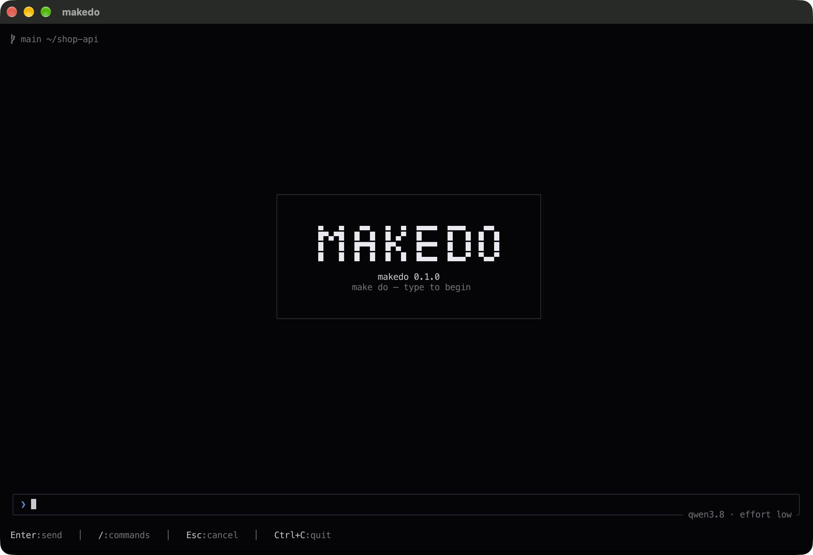

<p align="center">
  
</p>

<h1 align="center">makedo</h1>

<p align="center"><b>用便宜的模型，做正经的代码库。</b></p>

<p align="center">用 Rust 编写的编程智能体：单个二进制文件，可在终端或独立窗口中运行。</p>

<p align="center">
  <a href="../LICENSE"></a>
  
  
</p>

<p align="center">
  <a href="#这是什么">简介</a> ·
  <a href="#安装">安装</a> ·
  <a href="#快速开始">快速开始</a> ·
  <a href="#文档">文档</a>
</p>

<p align="center">
  <a href="../README.md">English</a> ·
  <a href="README.ru.md">Русский</a> ·
  <a href="README.es.md">Español</a> ·
  <b>简体中文</b> ·
  <a href="README.ja.md">日本語</a>
</p>

<p align="center">
  
</p>

---

## 这是什么

makedo 是一个在你的代码仓库里编写和修改代码的智能体。名字取自英文
*make do*：用手头现有的东西把事情办成。

便宜的模型（DeepSeek、Qwen、本地模型）在真实代码库上表现不佳，原因不是不够聪明，
而是缺少上下文纪律：在仓库里乱转、反复读同样的文件、重新发明已有的约定。makedo
用三样东西补上这个差距：

1. **知识层。** 位于 `.makedo/wiki/` 的 LLM wiki：一张关于项目事实的、带版本的图。
   它保存在 git 中，由便宜的模型来填充。
2. **纪律。** 先查 wiki，再用 grep；学到的东西要记下来；默认保持简洁（ponytail 技能）。
3. **自检。** 智能体必须反复运行类型检查和测试，直到全部通过。

## 数据

| 项目 | 数值 |
|---|---|
| 一个带测试和自检的功能 | 在 wiki 已预热的情况下，deepseek-v4-pro 花费 **$0.13**；质量相当时 sonnet 需要 $3.5–5.2 |
| 使用 wiki 时 | 运行最快、最稳定（5.8 和 6.0 分钟，其他为 8–24 分钟），diff 也更紧凑 |
| 填充 wiki | 35 万行的单体仓库约 $0.15 |
| 性能预算（CI 门禁） | 启动 < 150 ms，空闲内存 < 50 MB，二进制 < 15 MB |

来自真实待办列表的一个任务，五种配置，同一套三级验收：

| 配置 | 验收 | 用时 | 成本 |
|---|---|---|---|
| makedo + deepseek-v4-flash + wiki | ✓ | 3.1 分钟 | **$0.014** |
| makedo + deepseek-v4-pro + wiki | ✓ | 5.9 分钟 | $0.036 |
| makedo + 本地 qwen3.8 27b + wiki | ✓ | 14.9 分钟 | **$0** |
| `claude -p`，sonnet 5，无 wiki | ✓ | 4.9 分钟 | $2.19 |
| `claude -p`，opus 5，无 wiki | ✓ | 4.7 分钟 | $2.56 |

以上是项目自己在小样本上的测量结果。完整表格及其局限见
[BENCHMARKS.md](BENCHMARKS.md)（英语）。

## 功能

- **任意模型。** Anthropic、OpenAI、Gemini、DeepSeek、Qwen、OpenRouter、本地
  Ollama、自建的 OpenAI 兼容服务器，以及 ChatGPT 订阅。
- **Wiki 与项目记忆。** 保存在 git 中的知识图，加上支持全文与语义搜索的 SQLite
  记忆，所有 worktree 共享。
- **子智能体与 worktree。** 只读调研，以及在隔离的工作副本中修改代码。
- **双向 MCP。** 通过元工具（`search_tool` / `use_tool`）连接服务器；
  `makedo mcp-serve` 把 wiki 和记忆提供给其他智能体。
- **内置技能。** Ponytail、Open Code Review、Heavy，以及 DDD 和六边形架构准则，
  全部打包在二进制里，不依赖外部目录。
- **安全的文件编辑。** SHA-256 版本号、原子写入、跨会话共享的锁。
- **恢复会话。** `makedo --resume latest` 恢复历史记录。
- **macOS 窗口。** 同样的界面，以带 Dock 图标的应用形式运行。

## 安装

### 环境要求

- **系统：** Linux x86_64 或 arm64，或 macOS 11+（Intel 与 Apple Silicon）。
- **模型：** API 密钥（例如 `DEEPSEEK_API_KEY`、`ANTHROPIC_API_KEY`、
  `OPENAI_API_KEY`）、ChatGPT 订阅，或本地 Ollama。
- **Git：** 用于 wiki、记忆和 worktree；`makedo finish` 需要 2.38 或更高版本。
- **可选：** 安装了 `embeddinggemma` 模型的 Ollama（记忆的语义搜索），以及外部工具
  `heavy` 和 `ocr`。

### 预编译二进制

```sh
curl -fsSL https://raw.githubusercontent.com/ts-ign0re/makedo/main/install.sh | sh
```

脚本会识别你的平台，下载最新发布版，并把 `makedo` 放到 `~/.local/bin`。
如需安装到其他目录，请设置 `MAKEDO_INSTALL_DIR`。

### 从源码构建

需要 Rust 1.95 或更高版本。

```sh
git clone https://github.com/ts-ign0re/makedo && cd makedo
cargo install --path . --locked --profile dist
```

### macOS 应用

```sh
scripts/bundle-macos.sh        # 构建 target/Makedo.app
cp -R target/Makedo.app /Applications/
```

构建需要 Xcode Command Line Tools。应用启动时会询问项目文件夹；
`open -a Makedo --args ~/proj` 可直接打开指定文件夹。文字使用系统自带的 Menlo
字体绘制；Menlo 缺少的字形（盲文加载动画、标题栏里的分支图标）来自 JuliaMono
（OFL），它在构建时下载。文字字体可通过 `MAKEDO_FONT`（文件路径）更换，字号通过
`MAKEDO_FONT_SIZE`（磅，默认 14）调整。

这还是原型：使用 ad-hoc 签名（在别的 Mac 上需要手动允许运行），不支持用鼠标选择
文字，不支持 emoji，也没有 Linux 和 Windows 版本。不打包时可以这样启动窗口：
`MAKEDO_SYMBOLS_FONT=target/fonts/JuliaMono-Regular.ttf cargo run --features gui -- app`。

## 快速开始

```sh
cd your-project
makedo                                  # 交互界面；首次运行时选择提供商和模型
makedo login chatgpt                    # 用 ChatGPT 订阅登录
makedo -p "给购物车加一个测试" --yolo      # 无界面运行，工具调用自动批准
makedo --resume latest                  # 继续上一次会话
```

| 命令 | 作用 |
|---|---|
| `makedo models [--refresh]` | 模型目录及其刷新 |
| `makedo wiki check` | 检查 wiki 的完整性 |
| `makedo memory status\|search\|read\|write\|export` | 在命令行中使用项目记忆 |
| `makedo skills [名称]` | 内置技能 |
| `makedo mcp-serve` | 向其他智能体提供 wiki 和记忆的 MCP 服务器 |
| `makedo --worktree <名称>`、`makedo finish <名称>` | 在独立的工作副本中工作，然后合并 |
| `makedo demo` | 用测试事件演示界面，不向模型发送请求 |

在界面中可用：`/models`、`/effort`、`/theme`、`/doctrine`、`/ponytail`、`/agents`、
`/logs`、`/init`、`/worktree`、`/finish`、`/enrich`、`/create-image`、`/yolo`、
`/clear`、`/help`、`/quit`。

## 文档

大部分文档为俄语。

- [参考手册](REFERENCE.md)：提供商与模型、消息队列、文件编辑、日志、技能、记忆
- [产品核心](CORE.md)：论点、定位、测量结果
- [计划与原则](PLAN.md)
- [依赖](DEPS.md)
- [推理模式](REASONING.md)
- [记忆](MEMORY.md)
- [Worktree](WORKTREES.md)

## 许可证

makedo 以 **GNU 通用公共许可证第 3 版或更高版本**（GPL-3.0-or-later）发布。
完整文本见 [LICENSE](../LICENSE)。

第三方组件及其许可证列在 [THIRD-PARTY-NOTICES.md](../THIRD-PARTY-NOTICES.md) 中。
macOS 应用中的 JuliaMono 字体以 SIL Open Font License 发布，其许可证随字体一同放在
应用包内。
